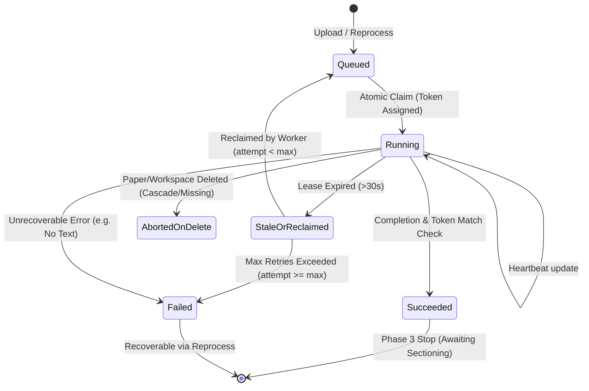

# ResearchMind AI — Phase 3 Implementation Plan: Persistent Processing and PDF Extraction

**Date:** 2026-10-17  
**Scope:** Week 2, Phase 3 (Persistent Processing and PDF Extraction)  
**Status:** In Progress — Stage 1 Grounding and Planning

---

## 1. Executive Summary & Boundaries

Phase 3 establishes the persistent document processing engine for ResearchMind AI:
- **Worker Process**: A standalone, resilient local worker decoupled from FastAPI's request lifecycle, implementing short transactions, atomic claims, claim-token fencing, heartbeat leases, and bounded retries.
- **Stage Progression**: Implements `validating` and `extracting` stages. Transactionally enqueues validation on paper upload. Stops cleanly after extraction, holding documents in an explicit `processing` state awaiting Phase 4 sectioning.
- **Extraction Engine**: Uses PyMuPDF to extract selectable text, one-based page numbers, character counts, stable block IDs (`p{page}_b{block}`), bounding boxes (`[x0, y0, x1, y1]`), page dimensions, and rotation conventions.
- **Metadata Provenance**: Extracts title, authors, publication year, and keywords while explicitly distinguishing source types (`"pdf"`, `"text"`, `"inferred"`). Missing fields remain null; no fabrication.
- **Quality Flags & Warnings**: Detects possible scans, unreliable tables, and missing equations per-page and aggregates document-level health. Distinguishes partial documents from all-image/no-text documents (which fail with explicit unsupported-text errors).
- **Inspection & Reprocessing APIs**: Extends `GET /api/papers/{id}/status`; implements `GET /api/papers/{id}/pages`, `GET /api/papers/{id}/pages/{page_number}/blocks`, and `POST /api/papers/{id}/reprocess`.
- **Phase Boundary**: Stops after extraction. Papers remain `status = "processing"`. No sectioning, chunking, embeddings, or `ready` status in Phase 3.

---

## 2. Architecture & Concurrency Model

```mermaid
sequenceDiagram
    autonumber
    actor User
    participant API as FastAPI Backend
    participant DB as SQLite (WAL Mode)
    participant FS as Local Storage (DATA_DIR)
    participant W as Local Worker

    Note over User, API: 1. Upload & Enqueue
    User->>API: POST /api/papers (PDF files)
    API->>FS: Stream & save PDF to data/pdfs/{paper_id}.pdf
    API->>DB: BEGIN TX: Insert Paper (status='uploaded') + Job (stage='validating', status='queued', run_id=R1) COMMIT
    API-->>User: 202 Accepted (batch response)

    Note over DB, W: 2. Worker Claim & Validation
    W->>DB: Atomic Claim: UPDATE processing_jobs SET status='running', worker_id=W1, claim_token=T1, heartbeat=now WHERE status='queued'
    W->>FS: Validate magic bytes, openability, and hash
    alt Validation Failed (Corrupt / Unreadable)
        W->>DB: UPDATE job SET status='failed', error=...; UPDATE paper SET status='failed'
    else Validation Succeeded
        W->>DB: BEGIN TX: UPDATE validating job status='succeeded'; INSERT extracting job (status='queued', run_id=R1); UPDATE paper status='processing' COMMIT
    end

    Note over DB, W: 3. Extraction & Heartbeat
    W->>DB: Atomic Claim: Claim extracting job (token T2)
    Note over W: Parse pages outside DB lock (PyMuPDF)
    loop Every Page
        W->>W: Extract text, blocks, char count, flags (scan/table/eq)
        W->>DB: Heartbeat: UPDATE job SET heartbeat_at=now WHERE id=job_id AND claim_token=T2
    end
    W->>W: Extract metadata (title, authors, year, keywords) + provenance

    Note over DB, W: 4. Atomic Publication
    W->>DB: BEGIN TX: Verify claim_token=T2; DELETE old pages; INSERT new pages; UPDATE paper metadata & quality; UPDATE extracting job status='succeeded' COMMIT
    Note over DB: Paper remains status='processing' (Awaiting Phase 4 Sectioning)

    Note over User, API: 5. Status & Inspection
    User->>API: GET /api/papers/{id}/status
    API->>DB: Query paper & jobs for run_id=R1
    API-->>User: 200 OK (status='processing', stage='extracting', progress=0.5, stages=[...])
    User->>API: GET /api/papers/{id}/pages
    API-->>User: 200 OK (pages list with flags and char counts)
    User->>API: GET /api/papers/{id}/pages/1/blocks
    API-->>User: 200 OK (page dimensions, rotation, blocks with bounding boxes)
```

### 2.1 Concurrency, Fencing, and Deletion Handling



---

## 3. Schema & Migration Plan

### 3.1 Migration `0003_add_processing_jobs_and_pages.py`

1. **`processing_jobs` Table**:
   - `id`: `String(36)`, Primary Key
   - `paper_id`: `String(36)`, ForeignKey(`papers.id`, ondelete="CASCADE"), nullable=False, indexed
   - `run_id`: `String(36)`, nullable=False, indexed (generation identifier)
   - `stage`: `String(32)`, nullable=False (`validating`, `extracting`, `sectioning`, `chunking`, `embedding`, `indexing`, `ready`)
   - `status`: `String(32)`, nullable=False, default=`queued` (`queued`, `running`, `succeeded`, `failed`)
   - `attempt`: `Integer`, nullable=False, default=1
   - `worker_id`: `String(100)`, nullable=True
   - `claim_token`: `String(36)`, nullable=True
   - `claimed_at`: `String(32)`, nullable=True (ISO UTC)
   - `heartbeat_at`: `String(32)`, nullable=True (ISO UTC)
   - `error_message`: `Text`, nullable=True
   - `started_at`: `String(32)`, nullable=True (ISO UTC)
   - `finished_at`: `String(32)`, nullable=True (ISO UTC)
   - `versions_json`: `Text`, nullable=True (JSON)
   - `created_at`: `String(32)`, nullable=False (ISO UTC)
   - Constraints:
     - Check: `status IN ('queued', 'running', 'succeeded', 'failed')`
     - Check: `stage IN ('validating', 'extracting', 'sectioning', 'chunking', 'embedding', 'indexing', 'ready')`
     - Check: `attempt >= 1`
     - Index: `idx_jobs_paper_run(paper_id, run_id)`
     - Index: `idx_jobs_status_stage(status, stage)`
     - Index: `idx_jobs_heartbeat(status, heartbeat_at)`

2. **`pages` Table**:
   - `id`: `String(36)`, Primary Key
   - `paper_id`: `String(36)`, ForeignKey(`papers.id`, ondelete="CASCADE"), nullable=False, indexed
   - `page_number`: `Integer`, nullable=False
   - `char_count`: `Integer`, nullable=False, default=0
   - `width`: `Float`, nullable=True
   - `height`: `Float`, nullable=True
   - `rotation`: `Integer`, nullable=True (0, 90, 180, 270)
   - `extraction_status`: `String(16)`, nullable=False, default=`ok` (`ok`, `partial`, `failed`)
   - `flags_json`: `Text`, nullable=False, default=`[]` (JSON list of strings)
   - `raw_text`: `Text`, nullable=True
   - `blocks_json`: `Text`, nullable=True (JSON list of block objects)
   - `created_at`: `String(32)`, nullable=False (ISO UTC)
   - Constraints:
     - Unique: `uq_pages_paper_page(paper_id, page_number)`
     - Check: `page_number >= 1`
     - Check: `char_count >= 0`
     - Check: `extraction_status IN ('ok', 'partial', 'failed')`

---

## 4. Requirement-to-Test Matrix (Spec-Driven Development)

| ID | Requirement | Implementation Target | Verification Test / Evidence |
|---|---|---|---|
| **REQ-1** | Persistent processing runs, stage attempts, constraints, and migration | `models.py`, `0003_*.py` | `test_phase3_migration.py`: migration up/down, FK cascade, constraints, existing Week 1 papers preserved |
| **REQ-2** | Transactional validation enqueue on upload & reprocess for existing papers | `paper_service.py`, `api/papers.py` | `test_phase3_enqueue.py`: upload creates paper + queued validation job in same TX; batch duplicate/reject intact |
| **REQ-3** | Standalone worker, atomic claims, bounded retries, lease/fencing recovery | `worker/engine.py`, `worker/main.py` | `test_phase3_worker.py`: atomic claim contention, stale token rejected on publish, lease expiry recovery, process tree cleanup |
| **REQ-4** | One-based page numbers, raw text, char counts, bounding boxes, dimensions, rotation | `backend/app/services/extraction_service.py` | `test_phase3_extraction.py`: PyMuPDF extractor on multi-page, multi-column, rotated PDF; verify exact coordinates & counts |
| **REQ-5** | Metadata provenance (title, authors, year, keywords) distinguishing PDF vs text vs inferred | `backend/app/services/extraction_service.py` | `test_phase3_extraction.py`: metadata source json matching contracts; missing fields remain null |
| **REQ-6** | Quality warnings (scans, tables, equations); all-image no-text explicit failure | `backend/app/services/extraction_service.py` | `test_phase3_quality.py`: scan-like warning, table warning, equation warning; all-image PDF results in explicit failure |
| **REQ-7** | Extended `/status`, `/pages`, `/pages/{num}/blocks`, and `/reprocess` (202 / 409) | `backend/app/api/papers.py`, `paper_service.py` | `test_phase3_api.py`: status reports real history; pages list & block inspection; reprocess 409 when active, 202 when allowed |
| **REQ-8** | Generation consistency & deletion safety | `backend/app/services/paper_service.py`, `worker/engine.py` | `test_phase3_concurrency.py`: deletion during worker processing discards output safely; failed replacement run leaves no orphan pages |

---

## 5. Execution Order

1. **Step 1: Database Models & Migration**
   - Update `backend/app/db/models.py` with `ProcessingJob` and `Page`.
   - Create migration `backend/migrations/versions/0003_add_processing_jobs_and_pages.py`.
   - Update `DATABASE_SCHEMA.md`.

2. **Step 2: Core Extraction & Quality Services**
   - Create `backend/app/services/extraction_service.py` for PyMuPDF text, block, dimension, rotation, metadata, provenance, and quality detection.
   - Implement scan-like, table, and equation heuristics. Handle all-image PDFs honestly.

3. **Step 3: Worker Engine & Processing Service**
   - Create `worker/engine.py` with `Worker` class: atomic claim with claim token, short transactions, heartbeat loop, stage handlers for `validating` and `extracting`.
   - Create `worker/main.py` CLI runner with graceful shutdown (`--poll-interval`, `--lease-timeout`, `--once`, `--max-retries`).
   - Create `backend/app/services/processing_service.py` for job enqueuing, reprocess requests, and status aggregation.

4. **Step 4: API Endpoints & Schemas**
   - Update `backend/app/schemas/paper.py` with `PaperStageDetail`, `PaperStatusResponse`, `PageSummaryItem`, `PagesListResponse`, `PageBlockItem`, `PageBlocksResponse`.
   - Update `POST /api/papers` in `paper_service.py` to enqueue validation job on upload.
   - Implement `GET /api/papers/{id}/pages`, `GET /api/papers/{id}/pages/{page_number}/blocks`, and `POST /api/papers/{id}/reprocess` in `backend/app/api/papers.py`.
   - Update `API_SPEC.md` and `worker/README.md`.

5. **Step 5: Automated Testing & Verification**
   - Unit & integration tests in `tests/backend/test_phase3_processing.py`.
   - Real multi-worker race and lease expiration tests.
   - Fixture verification (rotated, multi-column, table, scan-like, all-image).
   - Migration integrity and clean storage isolation tests.
   - Frontend and browser verification checks.

6. **Step 6: Review, Documentation, and Local Commit**
   - Update `decision.md`, `workflow.md`, `docs/PHASE_3_VERIFICATION.md`.
   - Review diff, check git status, commit locally on `manav`.
